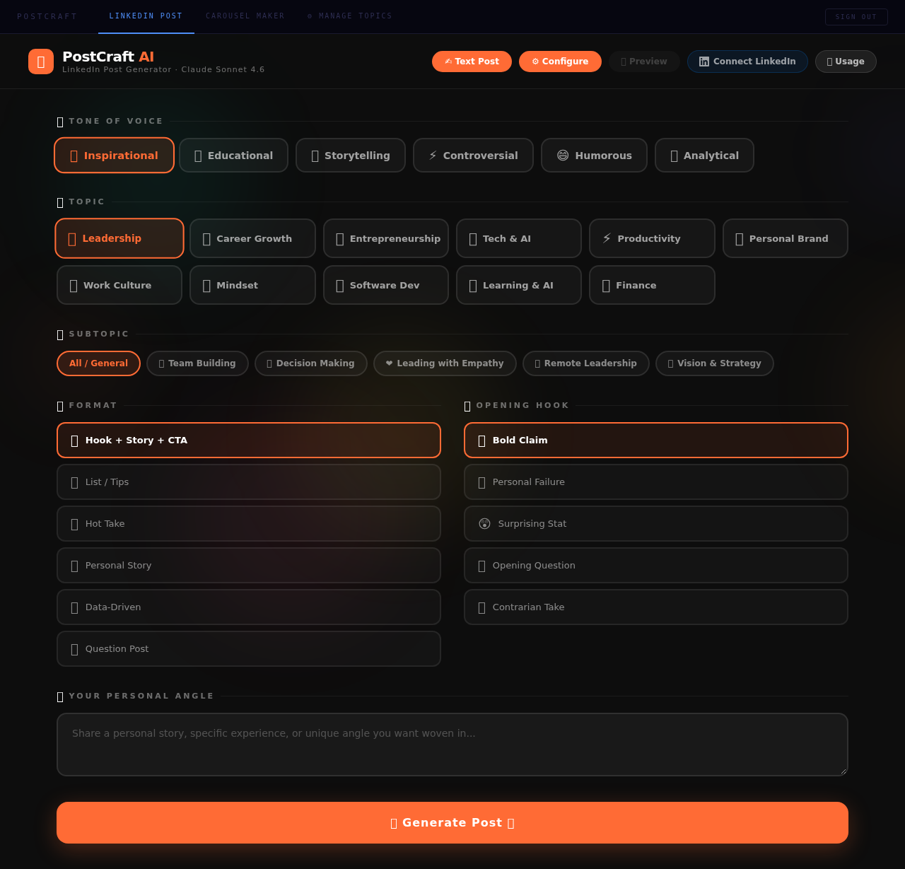

# Postcraft AI

[](https://github.com/Shilin237/postcraft-ai/actions/workflows/ci.yml)

A personal content workspace for drafting LinkedIn posts, creating ten-slide carousels and organising reusable topics. React and TypeScript handle the editor; a shared Node API keeps provider credentials and LinkedIn tokens out of browser JavaScript.



## What it does

* Generate editable post drafts and carousel previews with Claude.
* Organise topics locally and import spreadsheets.
* Connect a LinkedIn account through OAuth and explicitly publish a selected draft.
* Use the same protected handlers in local Express and Vercel deployments.

This is a single-owner application. It does not provide multi-user accounts, roles or a publishing queue. Review generated claims before publishing. AI and image providers can incur costs or be unavailable.

## Run locally

Requires Node.js 22 or later and npm. An Anthropic API key is needed for generation; tests use fake providers.

```sh
npm ci
cp .env.example .env
# Fill APP_USERNAME, APP_PASSWORD, SESSION_SECRET and ANTHROPIC_API_KEY.
npm run dev
```

Open http://localhost:5173. The API listens on port 3001. Generate a session secret with `openssl rand -hex 32`; never commit it. Keep `APP_URL` equal to the browser origin, including the port. Restart after editing environment variables.

LinkedIn is optional. Set its client ID and secret, register `http://localhost:5173/api/auth/callback` locally, and select a currently supported `LINKEDIN_API_VERSION` for the Posts API. Production uses `https://your-domain/api/auth/callback`. Your LinkedIn application must have the required sign-in and publishing permissions.

## Verify

```sh
npm test
npm run format:check
npm run build
npx playwright install chromium
npm run test:e2e
```

Server tests exercise real Express routes and the shared Vercel handler with fake providers. Browser tests exercise login, reload, tool loading and logout. They do not publish to LinkedIn or verify live provider permissions. CI runs these checks on pull requests.

## Deploy

Vercel builds `dist/` and serves `api/` functions. Configure the required environment variables first, with an HTTPS `APP_URL` and a new random `SESSION_SECRET`. Existing browser-only logins do not carry over. Configure both Redis REST variables when limits must be shared across instances. Default memory limits apply separately to each process and reset on restart.

For a Node deployment, run `npm run build` then `npm start` with environment variables supplied by your host and TLS at the reverse proxy. Proxy `/api` and the frontend through the same browser origin.

## Design and limitations

| Area | Implementation |
| --- | --- |
| UI | React 19, TypeScript, Vite, lazy-loaded tools |
| API | One implementation under `api/`, reused by `server/app.js` |
| Authentication | Encrypted one-hour HttpOnly cookie, server verification, origin and CSRF checks |
| OAuth | Random expiring state bound to the app session; encrypted LinkedIn cookie |
| Data | Topics and draft history in browser storage; no shared database |
| Abuse controls | Input/output bounds, provider timeouts, request limits |

See [architecture](docs/architecture.md), [security](SECURITY.md) and [contributing](CONTRIBUTING.md). Larger editor components and spreadsheet parsing remain candidates for further modularisation.
