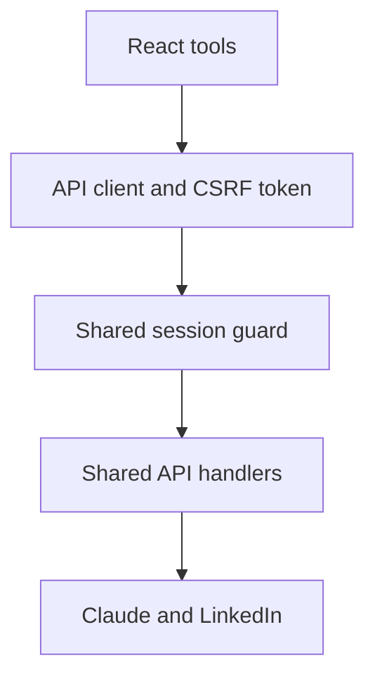

# Architecture

`src/App.tsx` restores the server session before showing tools and loads tool bundles on demand. `src/api.ts` holds the CSRF token in memory and reports expired sessions. Static component styles live in `src/styles/`.

`api/` is the authoritative implementation for both deployment modes. `server/app.js` mounts those exact handlers in Express; Vercel invokes them directly. The local proxy forwards only to this server, never directly to Anthropic. `server/security.js` owns configuration validation, authenticated encryption, cookies, CSRF, OAuth session binding and rate limits.

Generation accepts a bounded message payload and an allowlist of models. Carousel generation has a separate server prompt and returns HTML inline without filesystem storage. The image route proxies a fixed provider. Outbound requests have timeouts; errors do not return provider credentials or raw exception messages.

Tradeoffs: encrypted stateless cookies avoid a session database, but individual stolen sessions cannot be revoked centrally. A single shared owner account is suitable for personal use, not team access. Adding teams would require identity management, persistent sessions and per-user data isolation.
